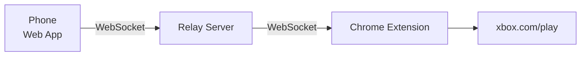

# Virtual Gamepad for Xbox Cloud Gaming

Use your phone as a controller for Xbox Cloud Gaming.

## What it is

Xbox Cloud Gaming runs in Chrome at [xbox.com/play](https://www.xbox.com/play) and needs a gamepad. This project lets a phone stand in for one. The phone shows a touch gamepad, and its input reaches xbox.com on your laptop as if a real controller were plugged in.

## Goal

Play cloud games on a laptop with only a phone as the controller:

- No physical gamepad
- No app to install on the phone, just a web page
- Low enough latency to play comfortably over home Wi-Fi

## How it works

The project has three parts:

1. **Virtual Gamepad Web App** (phone): a web page with an Xbox-style touch layout that sends the controller state.
2. **Relay Server** (laptop or local network): serves the web app and passes input from the phone to the laptop over WebSocket.
3. **Chrome Extension** (laptop): receives the input and shows it to xbox.com as a standard gamepad through `navigator.getGamepads()`.

## Status

The project is in the design phase.

## Modules

The project is a [Deno](https://deno.com) workspace. Each component is a module under `modules/`. Only the server may get implementations in other languages, each in its own folder.

| Folder | Component | Language |
|---|---|---|
| [modules/web-app/](modules/web-app/) | Virtual Gamepad Web App | TypeScript (Deno) |
| [modules/server/typescript/](modules/server/typescript/) | Relay Server | TypeScript (Deno) |
| [modules/chrome-extension/](modules/chrome-extension/) | Chrome Extension | TypeScript (Deno) |
| [modules/shared/](modules/shared/) | Shared code | TypeScript (Deno) |

## Documentation

| Document | What it covers |
|---|---|
| [ARCHITECTURE.md](docs/ARCHITECTURE.md) | Components, data flow, input protocol, reliability, performance and security |
| [DEVELOPMENT.md](docs/DEVELOPMENT.md) | Project layout, the no-dependency rule, tasks, playing and loading the extension |
