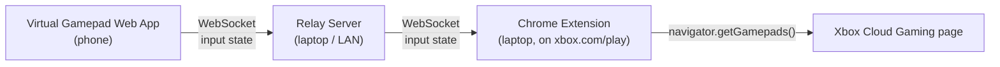

# Architecture: Virtual Gamepad for Xbox Cloud Gaming

## Goal

Use a phone as a gamepad for Xbox Cloud Gaming (xbox.com/play) running in Chrome on a laptop. The phone shows a touch gamepad. Its input reaches xbox.com as if a real controller were connected.

## Overview



All three parts talk over the local network. No Bluetooth: a web page cannot act as a Bluetooth device, only connect to one.

## Components

### 1. Virtual Gamepad Web App (phone)

A static web page opened in the phone's browser.

- **UI:** Xbox layout: two analog sticks (with click), D-pad, A/B/X/Y, LB/RB, LT/RT, View, Menu, Guide.
- **Input:** Pointer Events, one per finger, so multi-touch works.
  - **Sticks:** Tilt is the finger's distance from the stick center as a fraction of its radius, from -1 to 1 on each axis, with a radial dead zone. A finger that lands on a stick keeps driving it until it lifts. Double-tap and hold clicks the stick.
  - **Buttons:** A finger presses whatever is under it, so it can slide from one button to another.
  - **D-pad:** One touch area split into 8 directions, so diagonals press two buttons.
  - **Triggers:** Plain buttons for now. A touch has no pressure, so they send 0 or 1.
- **Output:** Sends the full controller state to the relay server over WebSocket. It sends whenever the state changes, plus a heartbeat about every 100 ms.
- **Display:** Landscape, fullscreen, no scroll or zoom. Optional haptic tap through the Vibration API.
- **Pairing:** The user enters or scans a session code shown by the extension.

### 2. Relay Server (laptop or LAN host)

A small server, run on the laptop by default. It accepts local connections only (`127.0.0.1`).

- **Serves** the built web app's static files over HTTP.
- **WebSocket endpoint** at `/ws?role=<role>&session=<code>`, with two roles:
  - `controller`: the phone web app
  - `host`: the Chrome extension
- **Sessions:** Pairs one controller with one host by session code, a 6-digit number. Either side can connect first. It forwards controller messages to the host unchanged. Messages from the host are ignored.
- **Stateless:** It doesn't interpret input and keeps no data beyond the live connections. A message sent while the host isn't connected is dropped, not stored.
- **Connects and disconnects:** It tells each side when the other one connects or drops (see `peer` below).
- **Dead connections:** It pings each client and drops one that doesn't answer within 5 s.

### 3. Chrome Extension (laptop)

A Manifest V3 extension active only on `https://www.xbox.com/*/play*`.

It has two scripts:

- **Bridge script** (content script, isolated world)
  - Opens the WebSocket to the relay server. `ws://localhost` is allowed from an HTTPS page. A server on another machine would need `wss://`.
  - Passes each state update to the page script through `window.postMessage`.
- **Page script** (content script, `"world": "MAIN"`, runs at `document_start`)
  - Replaces `navigator.getGamepads()` so the result includes a virtual `Gamepad` with `mapping: "standard"`, 17 buttons and 4 axes.
  - Fires `gamepadconnected` and `gamepaddisconnected` events.
  - Updates `timestamp` on every state change so the page sees new input.
- **Popup:** Shows connection status and the session code, and lets the user set the server address.

## Input Protocol

The same JSON message travels from the phone through the server to the extension:

```json
{ "t": "state", "seq": 1042, "b": 4097, "lt": 0.0, "rt": 0.85, "ax": [0.0, -1.0, 0.12, 0.0] }
```

| Field | Meaning |
|---|---|
| `t` | Message type: `state`, `hello`, `ping` |
| `seq` | Increasing sequence number. The extension drops stale messages. |
| `b` | Button bitmask. Bit *n* is standard-mapping button *n*. |
| `lt`, `rt` | Trigger values, 0 to 1 (buttons 6 and 7) |
| `ax` | `[leftX, leftY, rightX, rightY]`, -1 to 1 |

Standard mapping button indexes:

| Index | Button | Index | Button |
|---|---|---|---|
| 0 | A | 9 | Menu |
| 1 | B | 10 | Left stick click |
| 2 | X | 11 | Right stick click |
| 3 | Y | 12 | D-pad up |
| 4 | LB | 13 | D-pad down |
| 5 | RB | 14 | D-pad left |
| 6 | LT | 15 | D-pad right |
| 7 | RT | 16 | Guide |
| 8 | View | | |

### Server Messages

The server sends this to a client when the client joins a session, and again whenever the other side connects or disconnects:

```json
{ "t": "peer", "connected": true }
```

If the session already has a client with the same role, the server closes the new connection with code `4001`.

## Reliability

- **No stuck inputs:** If the extension gets no message for 500 ms, or the controller disconnects, it resets to a neutral state with all buttons released and sticks centered.
- **Reconnect:** The phone and the extension both reconnect automatically with backoff.

## Performance

- **Latency target:** under 20 ms from touch to page on the same Wi-Fi network.
- **Message size:** under 100 bytes. It can move to a binary format later if needed.
- **Connection:** One long-lived WebSocket per client, with Nagle's algorithm disabled (`TCP_NODELAY`) on the server.

## Security

- **Network:** Runs on the local network only.
- **Sessions:** A random session code is required to pair. The server rejects a second controller or host on the same session.
- **Permissions:** The extension requests access only to xbox.com.

## Open Questions

- Rumble: forward the page's `vibrationActuator` calls back to the phone?
- More than one virtual controller for local co-op?
- Serve over HTTPS (self-signed) to enable the Screen Wake Lock API on the phone?